  
 
    
 
  
 <h2 align="center">🚀 Featured projects</h2> 
   
 <h2 align="center">🛠️ Tech stack</h2> 
  
 
      
 <h2 align="center">🔭 Currently building</h2> 
 🔬 A model that predicts which clinical trials get terminated early  🤖 A research agent that combines clinical trial and research paper data 
 
